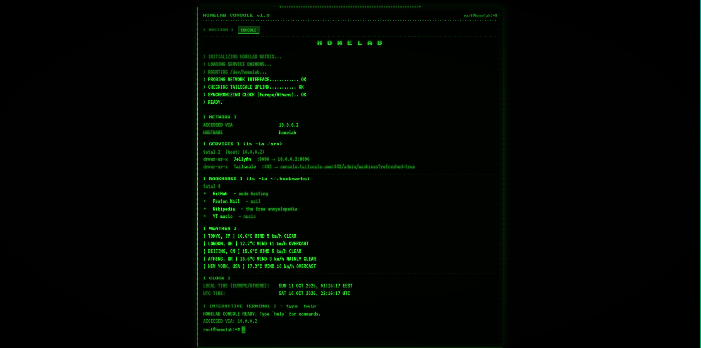
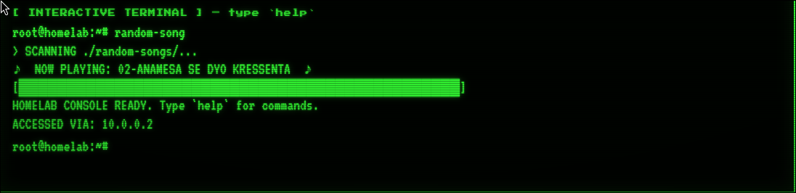
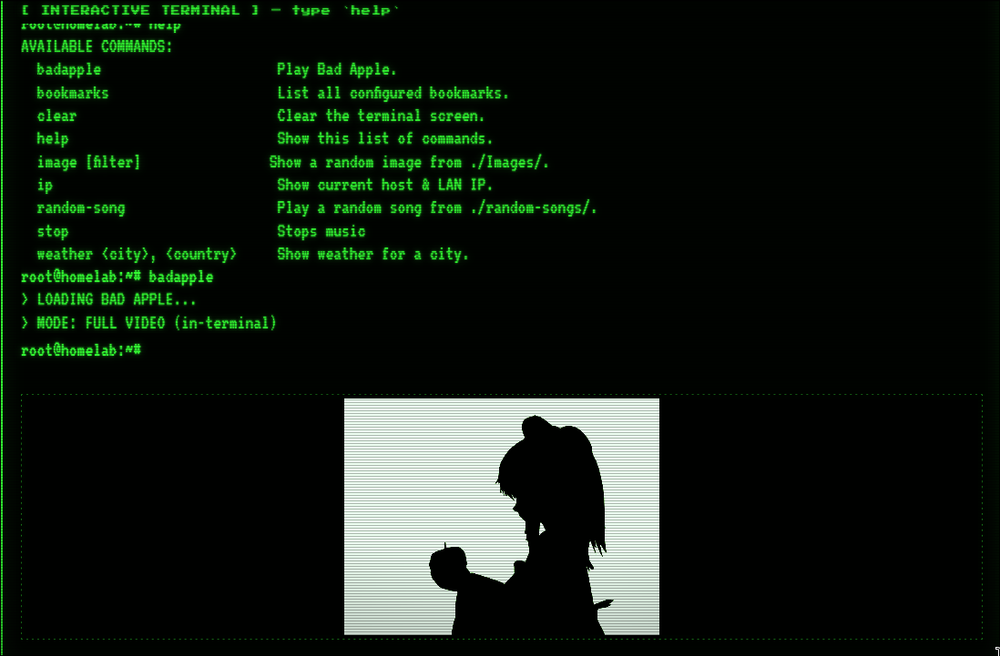

# Homelab Console

A retro CRT-style terminal dashboard for a personal homelab. Runs entirely
locally, no cloud, no accounts, no telemetry.



## Features

- Boot sequence with typewriter animation
- Auto-detecting service links (URLs are built from whatever host you're
  accessing the page from, so the same file works on `localhost`, on your
  LAN, and over Tailscale without edits)
- Live weather panel for configurable cities (Open-Meteo, no API key)
- Rotating quotes in the footer
- Interactive terminal with commands:
  - `help` — list all commands
  - `clear` — clear the terminal
  - `weather <city>, <country>` — live weather lookup
  - `image [filter]` — show a random image from `./Images/`
  - `random-song` — play a random track from `./random-songs/`
  - `bookmarks` — list configured bookmarks in the terminal
  - `badapple` — play Bad Apple in-terminal (video) or as ASCII + audio
  - `stop` — stop any playing media
  - `ip` — show the current host
- CRT effects: scanlines, flicker, chromatic aberration

## Requirements

- Python 3.9 or newer
- A modern browser

No dependencies. No `pip install`. No build step.

## Screenshots
- quote 

- random-song in use

- badapple in use


## Setup

1. Clone the repo:
   ```bash
   git clone https://github.com/Tsoibila/server-homepage.git
   cd server-homepage
   ```

2. Create the media folders (they're gitignored, so they won't exist
   after a fresh clone):
   ```bash
   mkdir -p Images stuff random-songs
   ```

3. Start the server:
   ```bash
   python3 serve.py
   ```

4. Open http://127.0.0.1:8000/ in your browser.

To stop the server, press `Ctrl+C` in the terminal where it's running.

*To start the server automatically on boot, see [start.md](start.md).*
## Configuration

Everything you need to edit lives in the `<script>` block at the top of
`index.html`. There's an editing guide in the comments, but the four
things you'll most likely want to change are:

**Services** — the links shown under `[ SERVICES ]`:
```js
const services = [
  { port: '8096', name: 'Jellyfin',  scheme: 'http' },
  { port: '443',  name: 'Tailscale', host: 'console.tailscale.com', scheme: 'https' },
];
```

Each entry needs at least `port` and `name`. Add `host` if the service
lives on a different machine. Add `path` if it needs a sub-path
(e.g. `/admin`). Add `scheme` only if you want to override the
auto-detected `http`/`https`.

**Bookmarks** — plain links, same idea:
```js
const bookmarks = [
  { name: 'GitHub',      url: 'https://github.com',          note: 'code hosting' },
  { name: 'Proton Mail', url: 'https://mail.proton.me',      note: 'mail' },
];
```

Optional fields: `note` for a trailing label, `icon` for a custom
single character (defaults to `▸`).

**Cities** — the weather panel:
```js
const CITIES = [
  { label: 'ATHENS, GR', lat: 37.9838, lon: 23.7275 },
];
```

Use any coordinates — the Open-Meteo API does the rest.

**Quotes** — the rotating footer messages:
```js
const QUOTES = [
  { text: 'Somewhere, something incredible is waiting to be known.', author: 'Carl Sagan' },
];
```

Each entry is `{ text, author }`. Add, remove, or reorder freely.

To change how often the quote cycles, find this line in the same
`<script>` block:
```js
setInterval(showQuote, 20000);
```
The number is in milliseconds, so `20000` = 20 seconds.

To make the page always start on the first quote instead of a random
one, find:
```js
let quoteIdx = Math.floor(Math.random()*QUOTES.length);
```
and change it to:
```js
let quoteIdx = 0;
```

## Media

The `image`, `random-song`, and `badapple` commands look for files in:

- `./Images/` — images (`.jpg`, `.png`, `.gif`, `.webp`, `.bmp`, `.svg`, `.avif`)
- `./stuff/` — anything media-related, same extensions as `Images/`
- `./random-songs/` — audio (`.mp3`, `.ogg`, `.wav`, `.m4a`, `.flac`)
- `./badapple.mp4` — optional; falls back to `./badapple.mp3` + ASCII animation if absent

These folders are empty in the repo on purpose. Drop your own files in
and reload the page — `serve.py` scans them on every request, so no
restart is needed.

## Adding a command

Commands live in the `COMMANDS` object in `index.html`. Each one is a
name plus a `{ help, usage?, run }` object:

```js
const COMMANDS = {
  hello: {
    help: 'Say hello.',
    run: (args, ctx) => { ctx.print('hello world'); }
  },
};
```

The `run` function receives `(args, ctx)`, where `args` is an array of
the words after the command, and `ctx` provides:

- `ctx.print(text, opts?)` — print a line. `opts.cls` can be `'out'` (default), `'cmd'`, or `'warn'`.
- `ctx.clear()` — wipe the terminal
- `ctx.play(url, { loop, volume })` — play audio
- `ctx.stopAudio()` — stop whatever is playing

The `help` command auto-lists every entry, so you don't need to update it
when you add one.

## How it works

`serve.py` is a small wrapper around Python's `SimpleHTTPRequestHandler`.
It serves files from the current directory and adds one extra endpoint:

```
GET /list/<folder>
```

…which returns `{"files": [...]}` for a whitelisted folder. The three
whitelisted folders are `stuff`, `Images`, and `random-songs`, each with
its own allowed file extensions. That's how the console knows what media
is available without hardcoding filenames.

`index.html` is a single file — all CSS and JS are inline. It talks to
`serve.py` for folder listings, and to a few public APIs for weather
(Open-Meteo) and geocoding (Open-Meteo Geocoding). No API keys are needed
for either.

## Notes on network exposure

`serve.py` binds to `0.0.0.0:8000` by default, which means it's reachable
from any device on the same network. That's fine on a trusted home LAN,
but don't run it on public Wi-Fi or a network you don't control. If you
want it reachable only from the machine it's running on, change this line
in `serve.py`:

```python
BIND_HOST = "0.0.0.0"
```

to:

```python
BIND_HOST = "127.0.0.1"
```

## License

Code: all rights reserved. You're welcome to read it and learn from it,
but please don't redistribute or host it as your own.

Photos and other media you add yourself are your own, they're not
covered by this license.
